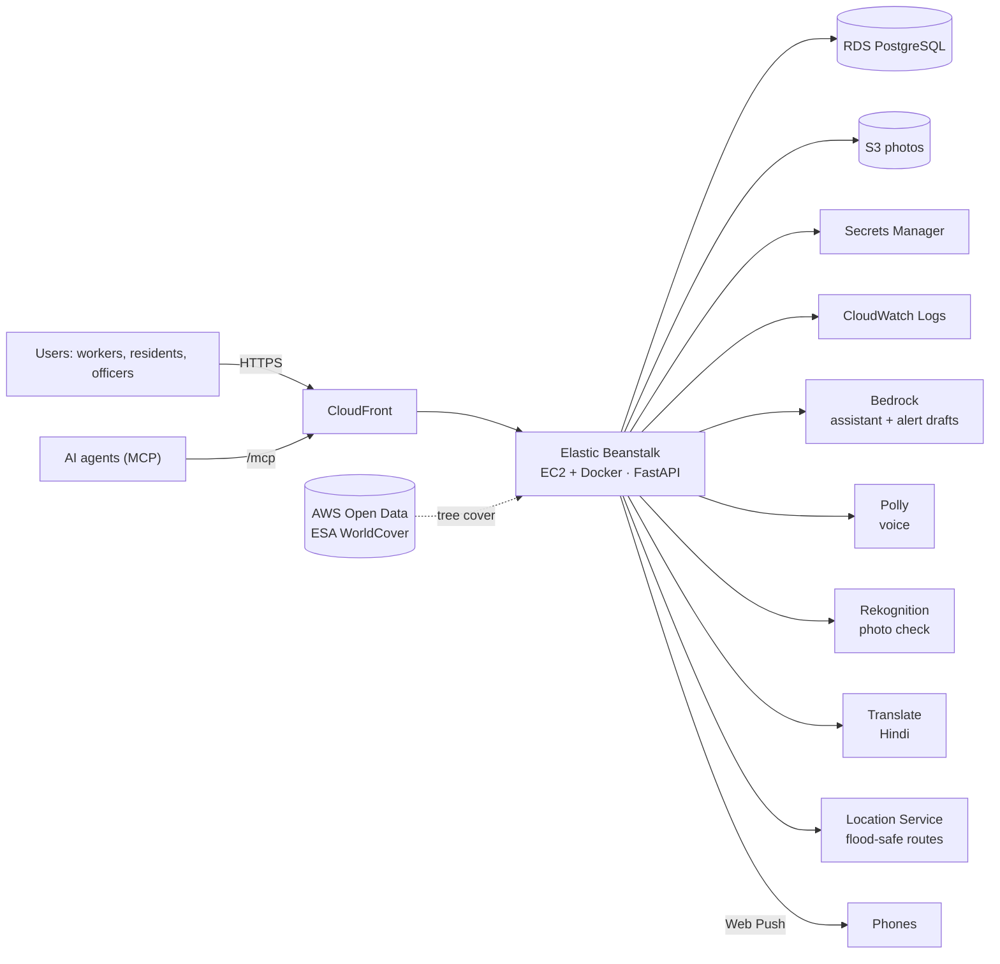

<p align="center"></p>

# Raहत (Rahat)

**Heat and flood early warning for Delhi's 290 wards.** Built for Hackathon 2026, Track 2: Heat and Water.

Rahat turns live weather, satellite land cover, terrain and citizen reports into ward-level warnings:
safe working hours for outdoor workers, a flood simulator, flood-aware routes, a citizen reporting app with
photo verification, a ward-officer console with AI-drafted alerts in English and Hindi, a chat and voice
assistant, an MCP server over the same data, and push alerts that reach a phone even with the app closed.

- `app/` – FastAPI backend (Python)  ·  `web/` – the built website  ·  `frontend/` – website source
- `scripts/prepare_data.py` – builds the city data from open sources  ·  `deploy/` – one-command AWS deploy
- `tests/` – 35 end-to-end tests (all external services faked)

## Architecture on AWS



Every 15 minutes the server pulls the forecast for a 6 × 6 grid over Delhi and blends it to each of the 290
wards, adjusting for satellite tree and built-up cover. Every 10 minutes it checks official NDMA warnings,
IMD-threshold forecast rules and citizen report clusters. Reports, alerts and broadcasts are pushed to open
dashboards instantly (Server-Sent Events).


# Rahat backend

(AWS resource names, the Python package and some internal identifiers still use the earlier project name `urbanshield`; renaming them would recreate the cloud resources.)

Heatwave and waterlogging early warning for Delhi, built on open data. FastAPI + SQLite (or Postgres).
It also serves the website from `web/`, so one deploy gives you the site and the API on the same address.

## What is real

| Feature | Source | Key needed |
|---|---|---|
| Ward boundaries (290 Delhi wards) | DataMeet Municipal Spatial Data (ODbL) | No |
| Live weather, 7-day forecast, last 30 days | Open-Meteo (CC BY 4.0), refreshed every 15 min on a 6 x 6 grid over Delhi, blended to each ward | No (free for non-commercial use) |
| Terrain for the flood model | Copernicus DEM GLO-90 through the Open-Meteo elevation API | No |
| Water points, shelters, parks, hospitals, underpasses, drains, Yamuna | OpenStreetMap through Overpass | No |
| Tree, green and built-up cover per ward | ESA WorldCover 10 m (Sentinel-1/2) from AWS Open Data | No |
| Official warnings | SACHET, NDMA's CAP feed (IMD, CWC, state authorities), filtered to Delhi | No |
| Forecast warnings | Open-Meteo forecast checked against IMD thresholds (heat wave 45 C, heavy rain 64.5 mm/24 h, bursts of 30 mm in 2 h) | No |
| Citizen reports with photos | Your own database; photos in S3 and checked by Amazon Rekognition on AWS | No |
| Report clusters raise alerts | 3+ waterlogging reports within 400 m in 2 h | No |
| Safer routes | Amazon Location Service on AWS (OSRM otherwise), each route scored against live flood reports and flood-prone underpasses; if all pass flooding, a route that avoids every spot | No |
| Addresses and search | Amazon Location Service on AWS, Nominatim (OpenStreetMap) otherwise | No |
| Safe hours for outdoor work | WBGT from forecast temperature, humidity and sunlight (Stull wet bulb), compared with ACGIH limits per workload | No |
| Officer queue, fix times, CSV export | Your own database, every status change logged | Officer token you choose |
| Broadcasts | Live app feed for everyone, English + Hindi (Amazon Translate); SMS / WhatsApp through Twilio | Twilio, optional |
| AI alert drafts and officer briefings | Amazon Bedrock (Claude or Amazon Nova), grounded in the live numbers; officer reviews before sending | AWS only |
| Chat and voice assistant | Amazon Bedrock tool use over the app's own data, Amazon Polly voice (Kajal, Indian English and Hindi); a rule-based assistant over the same tools without AWS | No (AWS for the AI and voice) |
| MCP server | The same tools for any MCP client, at `/mcp` (streamable HTTP) or `python -m app.mcp_server` (stdio) | No |
| Push alerts | Web Push (VAPID, RFC 8291 encryption), no Firebase account: rest now, safe again, heavy rain, official warnings | No |

Two parts are models, and the API says so in each response: the **flood simulator** ranks wards from
real terrain, land cover and rainfall (a screening model, not a hydraulic simulation), and the **heat
simulator** recomputes feels-like for a chosen temperature with the real humidity and wind.

## Run it on your computer (Windows, macOS or Linux)

You need Python 3.11 or newer.

```bash
cd urbanshield-backend
python -m venv .venv
# Windows:  .venv\Scripts\activate      macOS/Linux:  source .venv/bin/activate
pip install -r requirements.txt
copy .env.example .env          # macOS/Linux: cp .env.example .env
# edit .env: set OFFICER_TOKEN and CONTACT_EMAIL
python scripts/prepare_data.py  # 2-5 minutes, downloads elevation and OpenStreetMap layers
uvicorn app.main:app --reload
```

Open http://localhost:8000 for the site and http://localhost:8000/docs for the interactive API.
Weather loads within a few seconds of start-up; alerts follow straight after.

### Tree cover from satellites

`prepare_data.py` measures each ward's tree, vegetation, built-up and water share from **ESA WorldCover 2021**
(10 m land cover classified from Sentinel-1 and Sentinel-2 imagery, CC BY 4.0). It reads only the Delhi window
of the 3 x 3 degree tile from AWS, a few MB, and caches it in `data/cache/`. To add or refresh it without
redoing elevation and OpenStreetMap:

```bash
python scripts/prepare_data.py --landcover-only
```

The heat numbers then add a screening urban heat adjustment per ward, relative to the city average:
+2.0 C for a fully built-up ward and -4.0 C for full tree canopy (about -0.4 C per 10% more canopy), capped at
+/-2 C (tune with `UHI_BUILT_C`, `UHI_TREE_C`, `UHI_MAX_C`). The flood model uses the same cover for runoff.
OpenStreetMap parks are only used if the satellite step fails. Limits: 10 m pixels catch tree clumps and
avenues but miss single street trees, and the map is from 2021.

The site shows a green **Live** chip when it is talking to this server. Every screen then uses the API:
weather, alerts, reports (with photo upload), the flood and heat models, routes, safe hours and the
7-day forecast. **Ward ops** asks for the `OFFICER_TOKEN` from `.env` once and keeps it in that browser.
Opened any other way (for example as a file, or the published preview), the site falls back to example
data and says so. To point a copy of the site at another server, open it with `?api=https://your-server`.

Run the tests (no internet needed, every external API is faked with real response shapes):

```bash
pip install -r requirements-dev.txt
pytest -q
```

## Deploy

**AWS (recommended):** see [Deploy on AWS](#deploy-on-aws-one-command-from-aws-cloudshell) below. One command
creates everything; photos go to S3 and data to RDS, so nothing is lost on redeploy.

**Docker anywhere:** `docker build -t urbanshield . && docker run -p 8000:8000 --env-file .env urbanshield`

## API

Public
- `GET /api/health`, `GET /api/meta` (sources, channels, roles)
- `GET /api/wards` (GeoJSON), `/api/wards/search?q=`, `/api/wards/locate?lat=&lon=`
- `GET /api/weather/city`, `/api/weather/ward?ward_id=|lat=&lon=&hours=48`
- `GET /api/layers/{feels_like|rain_6h|temperature}?offset_h=0` (one value per ward)
- `GET /api/forecast?ward_id=` (7 days with risk labels)
- `GET /api/safe-hours?role=rider|construction|vendor&lat=&lon=` (hour by hour, plus nearest water and shade)
- `GET /api/history/unsafe-hours?ward_id=&days=30&threshold_c=42`
- `GET /api/alerts`
- `GET /api/places?lat=&lon=&kinds=drinking_water,shelter,community_centre,park`, `GET /api/underpasses`
- `GET /api/route?from=lat,lon&to=lat,lon`
- `GET /api/geocode?q=`, `GET /api/reverse?lat=&lon=`
- `POST /api/simulate/flood` `{rain_mm, hours, drains_clean, extra_storage_mm}`
- `POST /api/simulate/heat` `{air_temp_c, hour, extra_green_pct, cool_roofs}`
- `POST /api/reports` (multipart: kind, lat, lon, depth, description, photo), `GET /api/reports`, `GET /api/reports/{ref}`
- `POST /api/subscribe` `{phone, lat, lon, audiences, whatsapp}`, `DELETE /api/subscribe?phone=`
- `GET /api/stream` (Server-Sent Events: `report`, `alert`, `broadcast`)
- `POST /api/assistant/chat` `{messages:[{role,text}], lat, lon, ward_id, role, lang: en|hi}`, `GET /api/assistant/info`
- `POST /api/assistant/speak` `{text, lang}` (MP3 from Amazon Polly; 204 when Polly is off)
- `GET /api/push/key`, `POST /api/push/subscribe` `{subscription, ward_id, lat, lon, role, lang}`, `DELETE /api/push/subscribe` `{endpoint}`, `POST /api/push/test` `{endpoint}`
- `POST /mcp` (MCP, streamable HTTP)

Officer (header `Authorization: Bearer <OFFICER_TOKEN>`)
- `PATCH /api/reports/{id}` `{status, assignee, severity}`
- `GET /api/ops/summary`, `GET /api/ops/export.csv`
- `POST /api/broadcasts` `{message, ward_id, audiences, channels}`, `GET /api/broadcasts`
- `GET /api/simulate/flood/calibration?rain_mm=80` (how well the flood model matches real reports)

## Assistant, MCP server and push alerts

**Assistant (chat and voice).** The **Ask** button on the site opens a chat. Type, tap a suggestion, or tap
the mic and speak in English or Hindi (the browser turns speech into text). The server answers from eight
tools over live data: conditions now, safe hours, nearest water/shade/shelter, alerts, the 7-day forecast,
flood-aware routes, the flood what-if and place lookup (`app/tools.py`). On AWS, Amazon Bedrock decides which
tools to call and writes a short answer; Amazon Polly reads it aloud. Without AWS, a rule-based assistant calls
the same tools, so it works on a laptop. Answers come with buttons that open the right screen (place on the
map, the planned route, safe hours). Questions outside heat, rain, flooding and safety are declined, and
heat-illness symptoms get "stop, cool down, call 112 or 108".

**MCP server.** The same tools, read-only, for Claude Desktop, Claude Code or any agent:

- Remote: `https://<your-site>/mcp` (streamable HTTP). In Claude Desktop, add it as a custom connector, or:
  ```json
  {"mcpServers": {"urbanshield": {"command": "npx", "args": ["-y", "mcp-remote", "https://<your-site>/mcp"]}}}
  ```
- Local (stdio), from this folder: 
  ```json
  {"mcpServers": {"urbanshield": {"command": "python", "args": ["-m", "app.mcp_server"], "cwd": "<path to this folder>"}}}
  ```

**Push alerts.** In **Safe hours**, *Get alerts on this phone* asks for notification permission and subscribes
the browser (Web Push, works in Chrome, Edge, Firefox and Safari on iPhone once the site is added to the Home
Screen). No account or phone number: the server keeps only the browser's push address, the ward or position
rounded to about 100 m, the type of work and language. Every 5 minutes it checks each phone and sends at most
one message, most important first:

| Alert | When |
|---|---|
| Official warning | a new critical NDMA / IMD alert for Delhi |
| Rest now | heat turns unsafe for that type of work, with the nearest shade and water and how far |
| Heavy rain | 15 mm or more in the next 3 hours, naming the nearest underpass to avoid |
| Safe to resume | heat eases from unsafe |
| Heads-up | heat turns unsafe within the hour |
| Strong sun | strong sunshine in a ward with little tree cover |

Each kind is throttled, it is quiet from 10 PM to 6 AM except official, rest and rain alerts, and officer
broadcasts are pushed too. Tapping an alert opens the right screen, or walking directions to the shade.
The server signs pushes with its own VAPID key, created once and stored in the database (or set
`VAPID_PRIVATE_KEY`). Push needs HTTPS (CloudFront provides it) or `localhost`.

## Limits to know before going public

- Open-Meteo, Overpass, OSRM and Nominatim public servers are free with fair-use limits. The backend
  caches everything and calls each a few times an hour, which is well within them. For heavy traffic or
  commercial use, buy Open-Meteo's API plan and self-host OSRM and Nominatim.
- Weather models resolve a few kilometres, so wards next to each other share a forecast. The small
  urban heat adjustment from green cover is documented in `app/services/weather.py` (set `UHI_MAX_C=0` to remove it).
- SMS in India needs DLT registration of your sender and templates with TRAI before Twilio or any Indian
  provider will deliver. WhatsApp needs an approved WhatsApp Business sender.
- The officer token is a single shared secret, fine for a pilot. Use proper logins (Amazon Cognito) before a city rollout.
- The AWS setup is a single EC2 instance: fine for a pilot, not highly available. For a city rollout, move to a
  load-balanced Elastic Beanstalk environment (2+ instances) and Multi-AZ RDS.
- The Ravi film in the story section is AI-generated (Google Gemini) and labelled as such on the page.

## Deploy on AWS (one command, from AWS CloudShell)

1. In the AWS console, switch to **Asia Pacific (Mumbai) ap-south-1** and open **CloudShell** (the `>_` icon).
2. Actions → Upload file → `urbanshield-aws.zip`.
3. Run:

```bash
unzip -q urbanshield-aws.zip && cd urbanshield-backend && bash deploy/aws_deploy.sh
```

It takes about 25–30 minutes the first time (the database is the slow part) and prints the HTTPS link and the
officer token. Run it again after code changes to update. `bash deploy/aws_logs.sh` follows the server log;
`bash deploy/aws_destroy.sh` deletes everything so credits stop being used.

| AWS service | What Rahat uses it for |
|---|---|
| Elastic Beanstalk + EC2 (Docker) | runs the FastAPI server, built from the Dockerfile on AWS |
| Amazon RDS for PostgreSQL | reports, history, alerts, broadcasts, subscribers |
| Amazon S3 | report photos (private; served through short-lived signed links) |
| Amazon CloudFront | HTTPS for the site, needed for phone location and notifications |
| AWS Secrets Manager | database URL and officer token, read by the server at start-up |
| Amazon CloudWatch Logs | server logs, 7-day retention |
| Amazon Rekognition | checks report photos: blocks unsafe images; photos that show water are verified and raised in priority (two verified reports nearby raise a flood alert); photos with no water wait for an officer before they affect alerts or routes |
| Amazon Translate | broadcasts go out in English and Hindi |
| Amazon Bedrock | the chat assistant (tool use over live data), alert drafts and 72-hour officer briefings |
| Amazon Polly | speaks the assistant's answers in Indian English and Hindi (neural voice Kajal) |
| Amazon Location Service | road routes, including one that avoids every flooded spot; address search |
| AWS Open Data (ESA WorldCover) | satellite tree and built-up cover per ward |
| IAM | least-privilege role for the server |

Approximate cost while running: EC2 t3.small + RDS db.t4g.micro + small extras, about US$1–2 a day.
